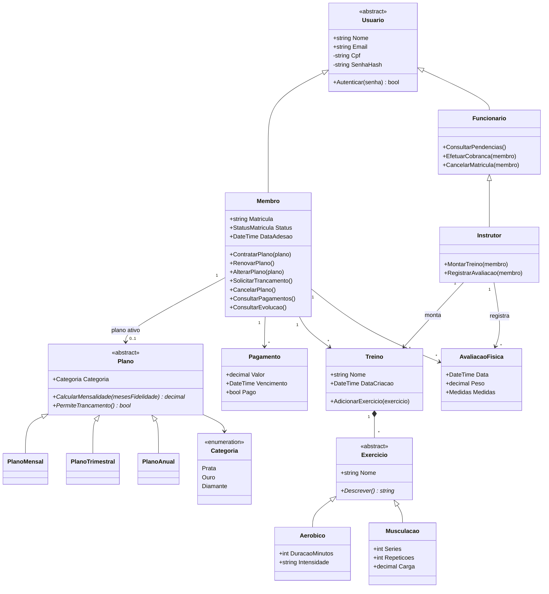

# Modelagem do Sistema (UML)

Estrutura estática do NexusFit sob a ótica da Orientação a Objetos, com um módulo de autenticação unificado para **Membros** e **Funcionários/Instrutores**.

## 1. Diagrama de Classes

## 2. Classes e Responsabilidades

| Classe | Tipo | Responsabilidade |
|---|---|---|
| **Usuario** | Abstrata | Atributos de autenticação (Nome, Email, Cpf, Senha) e o método comum de login. |
| **Membro** | Herda de Usuario | Aluno da academia. Possui matrícula, status e data de adesão. Contrata, renova, altera, tranca e cancela plano; consulta pagamentos, treinos e evolução. |
| **Funcionario** | Herda de Usuario | Equipe de gestão. Consulta pendências, efetua cobranças e cancela matrículas. |
| **Instrutor** | Herda de Funcionario | Monta treinos e registra avaliações físicas. |
| **Plano** | Abstrata | Base dos planos. Define `CalcularMensalidade()` e `PermiteTrancamento()` e carrega a `Categoria` de benefícios. |
| **PlanoMensal / PlanoTrimestral / PlanoAnual** | Concretas | Implementam as regras de mensalidade e trancamento de cada duração. |
| **Categoria** | Enum | Prata, Ouro e Diamante, com suas regras de acesso e benefícios. |
| **Exercicio** | Abstrata | Base dos exercícios. Define `Descrever()`. |
| **Aerobico / Musculacao** | Concretas | Exercícios aeróbicos (duração, intensidade) e de musculação (séries, repetições, carga). |
| **Treino** | Concreta | Conjunto de exercícios montado por um instrutor para um membro. |
| **AvaliacaoFisica** | Concreta | Registro de data, peso e medidas; base da consulta de evolução. |
| **Pagamento** | Concreta | Situação financeira da mensalidade (valor, vencimento, pago/pendente). |

## 3. Relacionamentos

- **Herança:** `Membro` e `Funcionario` herdam de `Usuario`; `Instrutor` herda de `Funcionario`; `PlanoMensal`, `PlanoTrimestral` e `PlanoAnual` herdam de `Plano`; `Aerobico` e `Musculacao` herdam de `Exercicio`.
- **Associação:** o `Membro` possui **no máximo um** `Plano` ativo, um histórico de `Pagamento`, vários `Treino` e várias `AvaliacaoFisica`.
- **Composição:** o `Treino` é composto por uma lista de `Exercicio`.
- **Autoria:** o `Instrutor` monta os `Treino` e registra as `AvaliacaoFisica`.

## 4. Pilares de POO no Projeto

| Pilar | Onde aparece |
|---|---|
| **Abstração** | Classes abstratas `Usuario`, `Plano` e `Exercicio`. |
| **Encapsulamento** | CPF, senha e status são privados e acessados por propriedades/métodos com validação. |
| **Herança** | Hierarquias `Usuario`, `Plano` e `Exercicio`. |
| **Polimorfismo** | `CalcularMensalidade()` e `PermiteTrancamento()` em cada plano; `Descrever()` em cada exercício. |

# Requisitos do Sistema

## Requisitos Funcionais (RF)

| Código | Requisito | Descrição |
|---|---|---|
| RF01 | Cadastro de usuários e perfis | Cadastrar **membros e instrutores/funcionários**, coletando nome, e-mail, CPF, senha e (para membros) número de matrícula. |
| RF02 | Autenticação por perfil | Validar credenciais (e-mail/CPF e senha) e direcionar o usuário ao painel correspondente (Membro ou Funcionário/Instrutor). |
| RF03 | Gestão de planos | Gerenciar planos **Mensal, Trimestral e Anual**, cada um com seu cálculo de mensalidade e regra de trancamento, combinados às categorias Prata, Ouro e Diamante. |
| RF04 | Contratação e renovação de plano | O membro escolhe o plano na adesão e pode **renová-lo**, alterá-lo, trancá-lo (se permitido) ou cancelá-lo. Respeita a regra de um plano ativo por vez. |
| RF05 | Painel e operações do funcionário | Consultar dados cadastrais dos membros, verificar pendências (ativo/inativo), efetuar cobranças e cancelar matrículas. |
| RF06 | Consulta de pagamentos e status | O membro consulta seu histórico de pagamentos e o estado atual da matrícula. |
| RF07 | Montagem de treinos | O **instrutor** monta e atualiza treinos compostos por exercícios, disponíveis para visualização pelo membro. |
| RF08 | Exercícios | Suporte a exercícios **aeróbicos** (duração, intensidade) e de **musculação** (séries, repetições, carga). |
| RF09 | Avaliação física | O instrutor registra avaliações físicas com **data, peso e medidas**. |
| RF10 | Consulta da evolução | O membro (e o instrutor) consulta a evolução física comparando as avaliações ao longo do tempo. |

## Requisitos Não Funcionais (RNF)

| Código | Requisito | Descrição |
|---|---|---|
| RNF01 | Aplicação de POO | Código estruturado nos quatro pilares: **Abstração, Encapsulamento, Herança e Polimorfismo**. |
| RNF02 | Linguagem e plataforma | Desenvolvido em **C#** no ecossistema **.NET**, com tipagem estática e segurança de compilação. |
| RNF03 | Encapsulamento de dados | Atributos sensíveis (senha, CPF, status financeiro/de matrícula) são `private`/`protected`, acessados apenas por propriedades ou métodos validadores. A **senha nunca é exibida** (nem a funcionários) e deve ser armazenada como **hash**. |
| RNF04 | Tratamento de erros | Exceções e entradas inválidas (campos vazios, dados incorretos, falha de autenticação) são tratadas sem interromper abruptamente a execução. |
| RNF05 | Padrões de código | Boas práticas de Clean Code: nomes descritivos, organização modular por arquivos e namespaces. |
| RNF06 | Versionamento | Todo o desenvolvimento versionado no GitHub, com histórico de commits e documentação atualizada. |
